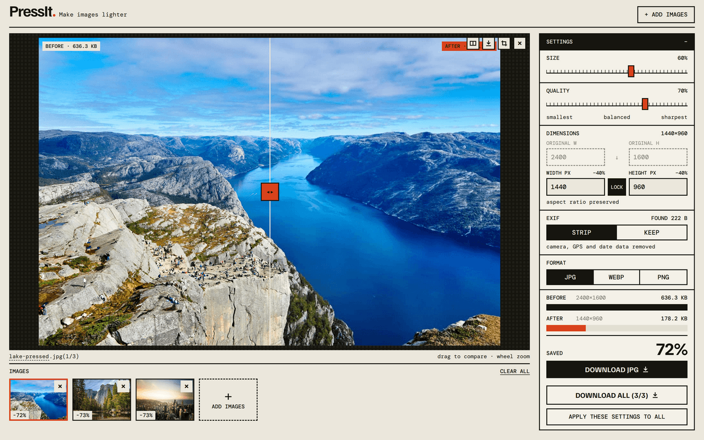
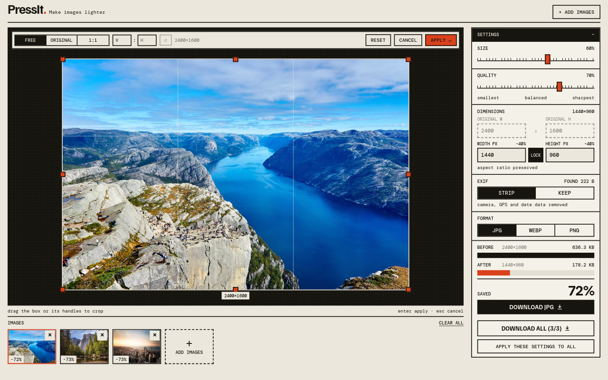

<p align="center">
  
</p>

<h1 align="center">PressIt</h1>

<p align="center">Make your images smaller. On your own computer, no uploads.</p>

<p align="center">
  
</p>

## What it does

- Drop, browse or paste images. Add as many as you like.
- Make them smaller: change size, quality and format (JPG, WebP, PNG).
- Crop to any shape.
- Drag the slider to compare before and after, and see how much space you saved.
- Remove hidden photo data (camera, GPS location, date) or keep it.
- Download one image or all of them.

Your images never leave your computer.

## Install and use

1. Install [Node.js](https://nodejs.org) (version 20 or newer).
2. Open a terminal and run:

   ```sh
   git clone https://github.com/AliReza99/pressit.git
   cd pressit
   pnpm install
   pnpm build
   pnpm start
   ```

3. Open <http://127.0.0.1:8787> in your browser.

To stop PressIt, press `Ctrl+C` in the terminal. To start it again later, run `pnpm start` in the `pressit` folder.

<p align="center">
  
</p>

## Update

```sh
git pull
pnpm install
pnpm build
```

## Questions

**Which images work?** JPG, PNG, WebP and GIF, up to 50 MB each. For GIFs, only the first frame is kept.

**Port 8787 is already in use.** Pick another one: `PORT=9000 pnpm start`, then open <http://127.0.0.1:9000>.

## For developers

<details>
<summary>Project layout, commands and API</summary>

### Layout

```
apps/
  web/      React 19 + Vite UI (TypeScript)
  api/      Hono on Node, image processing with sharp (libvips + mozjpeg)
packages/
  shared/   Constants, types and zod schemas shared by both apps
```

### Commands

```sh
pnpm dev        # web on http://localhost:3104 (proxies /api), api on http://127.0.0.1:8787
pnpm test       # api tests, run against the real sharp pipeline
pnpm typecheck
pnpm build      # builds web, then bundles the api
pnpm start      # api serves the built web app on http://127.0.0.1:8787
```

`PORT` and `HOST` override the API's listen address.

`ALLOWED_HOSTS` in `apps/web/.env` adds comma-separated hostnames the Vite dev server accepts (see `apps/web/.env.example`).

### API

| Method | Path | Body | Response |
| --- | --- | --- | --- |
| `POST` | `/api/images` | multipart `file` | `201` `SourceInfo` (id, oriented width/height, EXIF size) |
| `POST` | `/api/images/:id/compress` | JSON `CompressOptions` | `200` image bytes, with `x-output-width`, `x-output-height`, `x-exif-kept` headers |
| `DELETE` | `/api/images/:id` | | `204` |
| `GET` | `/api/health` | | `{ ok: true }` |

The original is uploaded once to the local API. Each settings change then sends only a small JSON body. The API keeps at most 16 originals in memory and evicts them after 30 idle minutes. If the API restarts, the web app uploads the image again on its own.

</details>

## License

[MIT](LICENSE)
